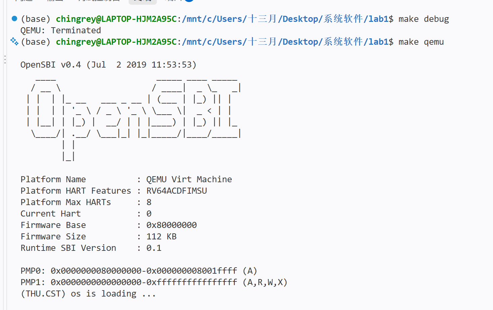
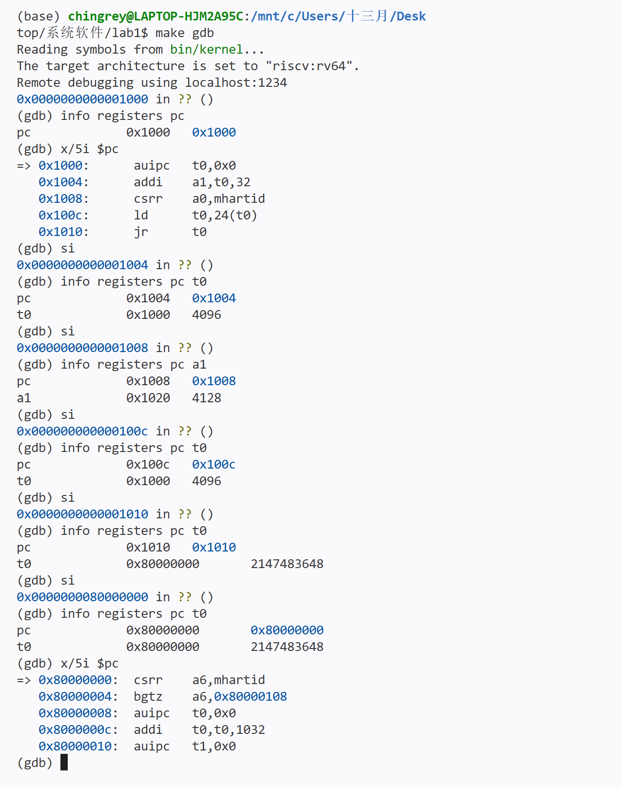
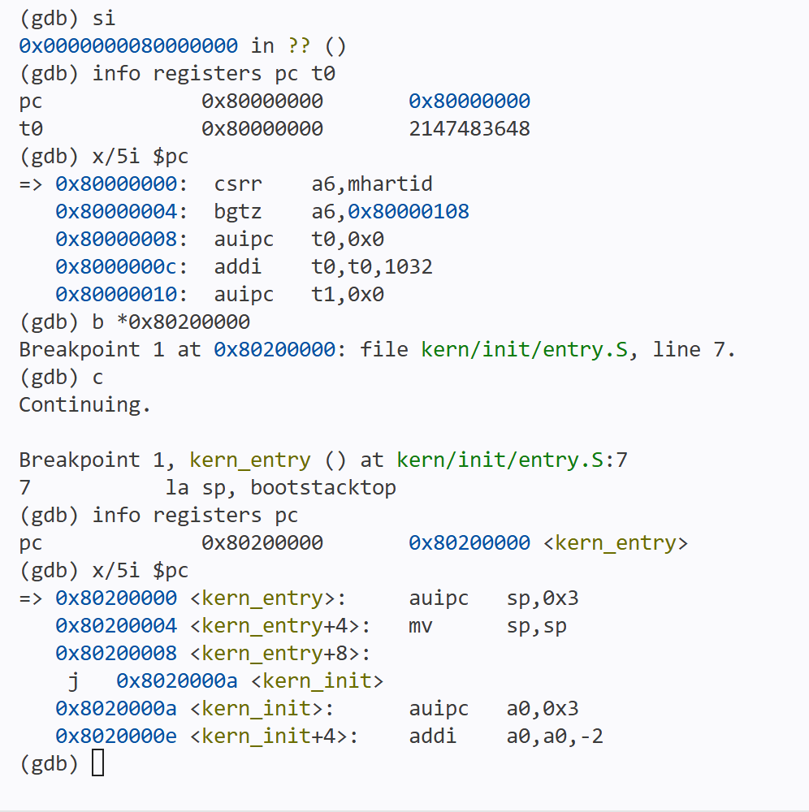

# 实验报告

## 实验基本信息

| 项目 | 内容 |
|---|---|
| 实验名称 | Lab1：最小可执行内核 |
| 小组成员 | 2513097－杨永琛、2513387－胡博延、2512885－李树青 |
| 完成日期 | 2026/10/10 |
### 小组分工

本组约定所有成员分别完成练习一、练习二。李树青负责撰写报告，其他成员审阅报告，核对解释和实验结果。

| 成员 | 实验任务 | 报告任务 |
|---|---|---|
| 2512885－李树青 | 练习一、练习二 | 撰写报告 |
| 2513097－杨永琛 | 练习一、练习二 | 审阅报告 |
| 2513387－胡博延 | 练习一、练习二 | 审阅报告 |

## 一、实验目的

本实验围绕最小可执行内核及其启动流程，在 QEMU 模拟的 64 位 RISC-V 计算机上运行内核。主要目标如下：

1. 理解链接脚本如何描述内核内存布局，以及入口地址与加载位置的关系。
2. 了解交叉编译、链接和格式转换过程，生成可执行文件与内核镜像。
3. 理解复位代码、OpenSBI 与内核之间的启动交接，并使用 GDB 验证启动流程。
4. 了解内核如何使用 OpenSBI 提供的服务输出格式化字符串，为调试提供信息。

## 二、实验环境

### 2.1 开发与运行环境

| 项目 | 本次记录 |
|---|---|
| 编辑器 | VS Code，使用 WSL 环境打开 lab1 |
| 系统环境 | WSL Ubuntu 26.04 LTS |
| 代码目录 | /mnt/c/Users/十三月/Desktop/系统软件/lab1/code |
| QEMU | 4.1.1，此前环境核对已确认 |
| RISC-V GCC | SiFive GCC 10.2.0，此前环境核对已确认 |
| RISC-V GDB | SiFive GDB 10.1，此前环境核对已确认 |
| 固件 | OpenSBI v0.4，见正常运行截图 |

VS Code 用于查看、编辑文件并打开终端；WSL 提供实验工具运行的 Linux 环境；QEMU 模拟 RISC-V 机器；GDB 用来控制模拟 CPU 并查看指令和寄存器。

### 2.2 AI 工具

| 成员 | AI 工具 | 底层模型 | 用途 |
|---|---|---|
| 2512885－李树青 | Codex | GPT-6.1sol（轻度） | 理解实验知识、辅助调试、核对结果和整理报告 |
| 2513097－杨永琛 | Codex | DeepSeek V4 Flash | 辅助解决课件未出现的问题，以及调试代码 |
| 2513387－胡博延 | Claude | DeepSeek | 辅助调试、完善代码、理解知识 |

## 三、实验整体逻辑分析

### 3.1 逻辑主线

本实验的主线是构建并启动一个最小可执行内核。QEMU 提供 64 位 RISC-V 模拟机器，内核通过编译和链接形成可执行文件，并按约定的内存布局装入模拟内存。CPU 从复位代码开始执行，经过 OpenSBI 的初始化后进入内核；内核设置启动栈，转入 C 初始化函数，并通过 OpenSBI 提供的服务输出启动信息。因此，理解本实验需要将编译与链接、内存布局、固件交接和内核入口操作联系起来。

### 3.2 构建与启动的顺序

在 WSL 的 code 目录执行 make，构建过程依次为：

源码 → 编译生成目标文件 → 链接生成 bin/kernel（ELF）→ 转换生成 bin/ucore.img（二进制内核镜像）。

ELF 包含机器代码及布局、符号等信息；内核镜像是用于保存和加载内核内容的文件形式。编译发生在模拟机器启动前，正常上电过程中不重新编译源码。

本次运行时，QEMU 提前读取真实电脑磁盘上的内核镜像，将其放入模拟内存的0x80200000。模拟 CPU 随后从0x1000执行复位代码，进入0x80000000的OpenSBI，再到达0x80200000的内核入口。

这省去了模拟机器自己从磁盘读取并装入内核的过程，没有省去OpenSBI的执行。真实机器的固件与引导程序分工因平台而异，不能把本次流程概括为所有机器都由OpenSBI从硬盘加载内核。

## 四、核心函数与功能模块理解

### 4.1 构建与内存布局

 Makefile 组织编译、链接和镜像转换。tools/kernel.ld 指定入口 kern_entry，并安排代码、只读数据、已初始化数据和 BSS 等区域。启动栈在 entry.S 的数据区域中预留；布局在链接时确定，实际内容由加载和初始化准备。

### 4.2 内核入口与初始化

 entry.S 设置 sp 后转入 init.c 的 kern_init。该函数调用 memset(edata, 0, end - edata)，将包含 BSS 的区域清零。BSS 主要保存初始值应为零的全局变量和静态变量，清零使其满足程序预期。随后调用 cprintf 输出启动信息，最后进入无限循环。

### 4.3 格式化输出与固件服务

 cprintf 位于 kern/libs/stdio.c，配合 libs/printfmt.c 处理格式和字符输出，经 kern/driver/console.c 的控制台接口及 libs/sbi.c 请求 OpenSBI 输出字符。它们分别承担格式处理、控制台接口和固件服务调用的工作，使最小内核能够打印信息来验证运行进度。

## 五、练习解答

### 5.1 练习一：理解内核启动中的程序入口操作

**问题：** 阅读 kern/init/entry.S，结合内核启动流程，说明 la sp, bootstacktop 和 tail kern_init 完成的操作及其目的。

OpenSBI 将执行转交给内核后，CPU 首先执行 entry.S 中的入口代码：

```asm
kern_entry:
    la sp, bootstacktop
    tail kern_init
```

**la sp, bootstacktop：** 将预留启动栈的顶部地址 bootstacktop 写入栈指针寄存器 sp。栈位于内存中，向低地址增长，用于保存函数运行时所需的临时数据、寄存器值和返回地址等。这条指令设置已有栈空间的使用位置，为后续 C 函数运行建立可用的栈，而不是现场分配新的内存。

**tail kern_init：** 将执行转到 kern/init/init.c 中的 kern_init，不建立新的返回地址。kern_init 完成初始化并打印启动信息，随后进入无限循环，不会返回。因此，该指令使内核从汇编入口转入 C 初始化阶段。

### 5.2 练习二：使用 GDB 验证启动流程

**问题：** 跟踪从加电到内核入口的过程，说明最初几条指令的位置和功能，并记录调试结果。

#### 5.2.1 调试过程

在两个 WSL 终端中进入代码目录，分别执行 make debug 和 make gdb。前者启动 QEMU 并暂停 CPU，后者连接调试端口 localhost:1234。连接后使用以下命令查看初始位置和指令，再逐次单步执行：

```gdb
info registers pc
x/5i $pc
si
info registers pc t0
```

初始 PC 为 0x1000。单步过程中按需查询 a1，观察启动参数准备与 t0 的变化；执行最后的 jr t0 后，PC 变为 0x80000000，确认进入 OpenSBI。

随后设置内核入口断点并继续运行：

```gdb
b *0x80200000
c
info registers pc
x/5i $pc
```

GDB 命中 kern_entry 断点，PC 为 0x80200000，对应 entry.S 中的 la sp, bootstacktop，验证了从固件到内核入口的交接。此时第一条内核指令尚未执行。

其中，si 执行一条机器指令后暂停；c 连续执行，直到遇到断点等停止事件。断点指定暂停位置，不会跳过中间的 OpenSBI 代码。

#### 5.2.2 最初指令的位置与功能

在本实验的 QEMU RISC-V 平台中，最初五条指令从复位地址 0x1000 开始，位于 0x1000～0x1010：

| 地址 | 指令 | 主要功能 | 实际观察 |
|---|---|---|---|
| 0x1000 | auipc t0,0x0 | 将当前地址存入 t0，作为计算基准 | t0=0x1000 |
| 0x1004 | addi a1,t0,32 | 计算启动信息地址并存入 a1 | a1=0x1020 |
| 0x1008 | csrr a0,mhartid | 读取当前硬件线程编号到 a0 | 单步后 PC=0x100c，未查询 a0 |
| 0x100c | ld t0,24(t0) | 从 0x1018 读取 OpenSBI 入口地址 | t0=0x80000000 |
| 0x1010 | jr t0 | 跳转到 OpenSBI 入口 | PC=0x80000000 |

这些复位指令准备启动信息、读取硬件线程编号并取得 OpenSBI 入口地址，最后跳转到 0x80000000。OpenSBI 完成初始化后，将执行转交给 0x80200000 的内核入口。单步结果与入口断点共同验证了这一流程。

本实验由 QEMU 提前将内核镜像装入模拟内存，调试观察的是执行交接，而不是 OpenSBI 从磁盘加载内核的过程。

## 六、测试与验证

### 6.1 正常运行

曾执行make，输出Nothing to be done for 'TARGETS'，表示现有目标无需更新。随后make qemu输出OpenSBI信息和内核文字，证明执行到了kern_init中的打印代码。



截图上方QEMU: Terminated属于之前调试实例终止的记录，不是本次正常运行失败。

### 6.2 复位代码单步执行



截图包含初始PC、最初五条指令、逐次单步和关键寄存器值，以及进入OpenSBI后的反汇编，是5.2.2节的依据。

### 6.3 内核入口断点



截图包含断点设置、继续执行、命中kern_entry、PC查询及入口反汇编，是5.2.1节内核入口验证的依据。

本次验证结果为内核运行输出、复位代码单步观察和内核入口断点命中。

## 七、重要知识点与 OS 原理的联系和差异

### 7.1 系统启动与控制权交接

 OS 原理中的启动过程需要先准备运行环境，再进入内核。本实验通过复位代码、OpenSBI 和内核入口体现这一过程。区别在于，QEMU 提前装入镜像，省去了模拟机器从磁盘读取内核的步骤；因此观察到的是执行交接，而不是完整的磁盘引导过程。

### 7.2 程序布局与初始化

 程序需要为指令和数据安排空间，并保证数据具有正确的初始值。本实验通过链接脚本确定各区域的位置，并由 kern_init 清零 BSS。链接时确定位置、加载时装入内容、启动时初始化，是相互衔接但不同的工作。

### 7.3 函数运行与内核栈

 函数运行需要保存临时数据、部分寄存器值和返回地址等。本实验在入口设置 sp，使后续 C 函数可以使用预留的启动栈。这里的“栈”是内存中的数据空间，sp 是 CPU 中保存栈位置的寄存器，使用栈不等于跳到栈中执行指令。

### 7.4 内核输出与固件服务

 操作系统需要提供访问设备的接口。本实验通过内核输出函数请求 OpenSBI 服务来输出字符，说明内核可以借助固件完成底层操作，而不是所有设备访问都由内核自行实现。这里讨论的是控制台输出，不能据此认为已经实现完整的设备管理。


